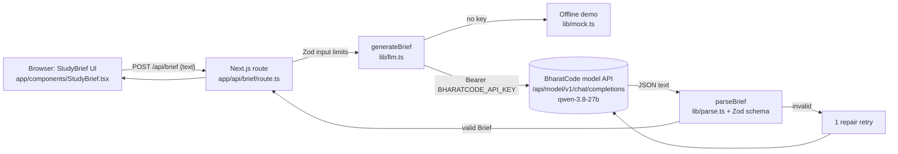

# 📘 StudyBrief – AI Research & Study Companion

Paste a topic, an article or your class notes and StudyBrief turns it into a **study brief**:

- 🔑 Key points
- 💡 A simple explanation
- 📖 Important terms with definitions
- 📝 A flip-card practice quiz (click to reveal each answer)
- 🧒 An optional "Explain like I'm 15" version
- ⬇️ Copy as Markdown or download a `.md` file

All AI calls use the **[BharatCode model API](https://bharatcode.ai/build)**. Built for the [BharatCode Build League](https://bharatcode.ai/hackathon).


## Architecture



- **Next.js 15 App Router + TypeScript**, no UI framework, one CSS file.
- The API key never reaches the browser; only the server route calls BharatCode.
- The model is asked for JSON matching a JSON Schema (`response_format: json_schema`). Its reply is cleaned (code fences and `<think>` blocks removed) and validated with **Zod**. If validation fails, the error is sent back to the model **once** for repair; a second failure returns a clear error.
- A 503 ("model busy" per the BharatCode docs) is retried twice with a short wait. `finish_reason: length` is reported as cut-short output rather than parsed.

## Setup

Requires Node 20+.

```bash
npm install
cp .env.example .env    # then add your key
npm run dev             # http://localhost:3200 (PORT=xxxx to change)
```

### Getting a BharatCode API key

1. Sign in at [bharatcode.ai](https://bharatcode.ai/login).
2. Create a developer API key at [bharatcode.ai/account](https://bharatcode.ai/account). API access needs Lite, Pro or verified student access (students get 10M tokens a day on `qwen-3.8-27b`).
3. Put it in `.env` as `BHARATCODE_API_KEY=...`.

| Variable | Default | Purpose |
|---|---|---|
| `BHARATCODE_API_KEY` | _(empty → offline demo)_ | Bearer token for the model API |
| `BHARATCODE_BASE_URL` | `https://bharatcode.ai/api/model/v1` | OpenAI-compatible base URL |
| `BHARATCODE_MODEL` | `qwen-3.8-27b` | `deepseek-v4.1-flash` needs Pro |
| `STUDYBRIEF_MODE` | – | `mock` forces the offline demo |

### How the API call works

```bash
curl https://bharatcode.ai/api/model/v1/chat/completions \
  -H "Authorization: Bearer $BHARATCODE_API_KEY" -H "Content-Type: application/json" \
  -d '{"model":"qwen-3.8-27b","messages":[{"role":"user","content":"Say hello from BharatCode"}]}'
```

StudyBrief sends a system prompt plus your text (wrapped in `<source>` tags, treated as material, not instructions), `max_tokens: 4000`, `reasoning_effort: "none"` and a JSON schema `response_format`. See `lib/llm.ts`.

### Offline demo mode

With no key, StudyBrief returns a deterministic placeholder brief. It is labelled **"Offline demo"** in the header pill, the title and every section, so it can never pass as model output.

> A local-only OpenAI test fallback exists (`STUDYBRIEF_TEST_FALLBACK=openai` + `OPENAI_API_KEY`) for developing when BharatCode is unreachable. It is off by default, labelled in red in the UI, and must not be used for the hackathon demo.

## Scripts

```bash
npm run lint && npm run typecheck && npm test && npm run build
```

Tests (`tests/parse.test.ts`, vitest) cover JSON extraction, schema validation, input limits, the mock, Markdown export and provider selection.

## Demo flow (≈90 s)

1. Open the app – the pill shows **BharatCode model API · qwen-3.8-27b**.
2. Click the **Notes: French Revolution** example (or paste your own notes) → **Generate study brief** (Ctrl/⌘+Enter works too).
3. Walk through key points, the simple explanation and the terms.
4. Click quiz cards to flip and reveal answers.
5. Toggle **Explain like I'm 15**.
6. **Download .md** – a ready-to-revise notes file.

## Project layout

```
app/page.tsx, app/components/StudyBrief.tsx   UI
app/api/brief/route.ts                        API route (server-only key)
lib/schema.ts   Zod + JSON schema, input limits
lib/llm.ts      BharatCode client, repair retry, provider selection
lib/parse.ts    JSON extraction + validation
lib/prompt.ts   prompts      lib/mock.ts   offline demo
lib/markdown.ts Markdown export
tests/          vitest       docs/         screenshots
BharatCode.txt  required by the Build League
```

## License

MIT
