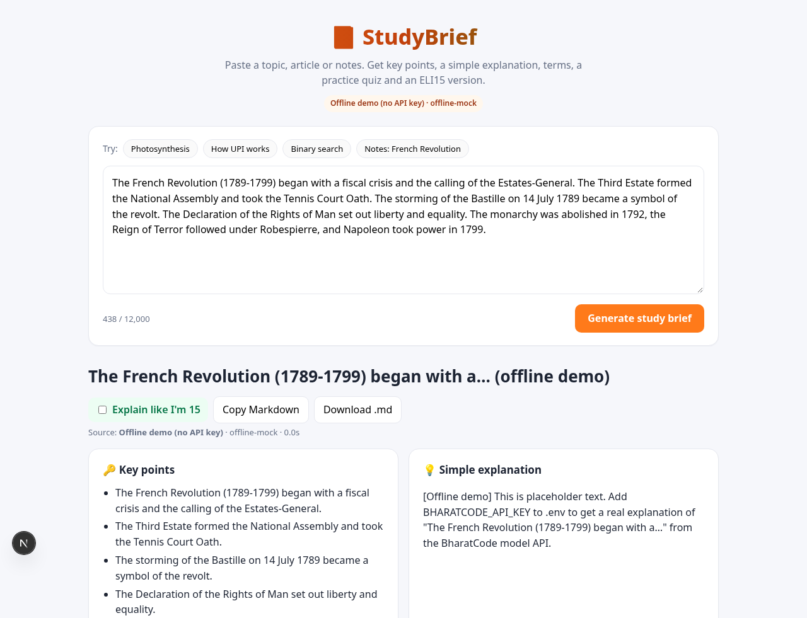
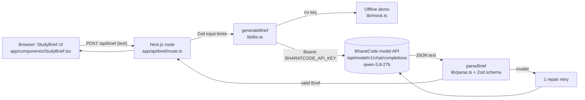

# 📘 StudyBrief — notes to lasting recall

A revision companion for students who can recognize an answer but cannot yet recall it. Paste class notes, attempt source-linked questions, record confidence, and return to a personal review queue that prioritizes confident mistakes.

## The learning loop

1. **Revise my notes:** paste 80–12,000 characters. BharatCode generates an overview and 3–6 multiple-choice questions with exact quotations from the notes.
2. **Attempt before reveal:** choose an answer and confidence level. Evidence and explanation appear only after checking the answer.
3. **Inspect the evidence:** quotes are checked against the source on the server, with one repair attempt for invalid citations. This verifies quote membership, not semantic correctness; the summary remains model-generated.
4. **Track gaps:** missed concepts and confident mistakes remain visible in your session library.
5. **Return to review:** misses are due in 10 minutes, correct answers with low/medium confidence in one day, and confident correct answers in 3, 6, 12, then 14 days with repeated success. This is a transparent heuristic, not a validated mastery score.
6. **Resume later:** the latest ten sessions, original notes and question-level progress persist in this browser. Delete individual sessions to remove their saved copies. There is no account, cross-device sync, or notification service.

**Explore a topic** preserves the original summary, terms, flashcards, ELI15 and Markdown export flow. It uses general model knowledge, has no checked source, and does not create a review session.

All AI calls use the **[BharatCode model API](https://bharatcode.ai/build)**. Built for the [BharatCode Build League](https://bharatcode.ai/hackathon).




## Demo video

▶️ [Watch the full feature demo (MP4)](docs/demo.mp4) — captioned screen recording of real BharatCode generation, confidence checks, evidence, saved progress, topic briefs, ELI15, flashcards, export, deletion, limits and a separately labelled offline demo. Model waiting time is shortened; answers and review dates are not altered. See [chapters and reproduction instructions](docs/DEMO.md).

## Architecture



- **Next.js 15 App Router + TypeScript**, no UI framework, one CSS file.
- The API key never reaches the browser; only the server route calls BharatCode.
- The model is asked for JSON matching a JSON Schema (`response_format: json_schema`). Its reply is cleaned (code fences and `<think>` blocks removed) and validated with **Zod**. If validation fails, the error is sent back to the model **once** for repair; a second failure returns a clear error.
- A 503 ("model busy" per the BharatCode docs) is retried twice with a short wait. `finish_reason: length` is reported as cut-short output rather than parsed.

## Setup

Requires Node 20+.

```bash
npm install
cp .env.example .env    # then add your key
npm run dev             # http://localhost:3200 (PORT=xxxx to change)
```

### Getting a BharatCode API key

1. Sign in at [bharatcode.ai](https://bharatcode.ai/login).
2. Create a developer API key at [bharatcode.ai/account](https://bharatcode.ai/account). API access needs Lite, Pro or verified student access (students get 10M tokens a day on `qwen-3.8-27b`).
3. Put it in `.env` as `BHARATCODE_API_KEY=...`.

| Variable | Default | Purpose |
|---|---|---|
| `BHARATCODE_API_KEY` | _(empty → offline demo)_ | Bearer token for the model API |
| `BHARATCODE_BASE_URL` | `https://bharatcode.ai/api/model/v1` | OpenAI-compatible base URL |
| `BHARATCODE_MODEL` | `qwen-3.8-27b` | `deepseek-v4.1-flash` needs Pro |
| `STUDYBRIEF_MODE` | – | `mock` forces the offline demo |
| `STUDYBRIEF_RATE_LIMIT` | `8` | Briefs per IP per window |
| `STUDYBRIEF_RATE_WINDOW_MS` | `600000` | Rate-limit window (10 min) |
| `STUDYBRIEF_MAX_CONCURRENT` | `4` | Max in-flight generations per instance |

### Deploying to Vercel

1. Import the GitHub repo at [vercel.com/new](https://vercel.com/new) (framework: Next.js, defaults are fine).
2. In **Project → Settings → Environment Variables**, add `BHARATCODE_API_KEY` (mark it *Sensitive*) for Production and Preview. Optionally set `BHARATCODE_MODEL`.
3. Deploy (or redeploy after adding the variable). The header pill shows **BharatCode model API** when the key is picked up.

Or with the CLI: `vercel env add BHARATCODE_API_KEY production` then `vercel --prod`. Never commit `.env`; it is git-ignored.

### Abuse protection

`POST /api/brief` applies an in-memory per-IP limit (first `x-forwarded-for` hop, 8 requests / 10 min) and a global concurrency guard. Over the limit it returns HTTP 429 with a `Retry-After` header and a friendly message shown in the UI. State is per warm serverless instance, so it is best-effort, which is fine for a demo; use a shared store (e.g. Upstash Redis) for strict limits.

### How the API call works

```bash
curl https://bharatcode.ai/api/model/v1/chat/completions \
  -H "Authorization: Bearer $BHARATCODE_API_KEY" -H "Content-Type: application/json" \
  -d '{"model":"qwen-3.8-27b","messages":[{"role":"user","content":"Say hello from BharatCode"}]}'
```

StudyBrief sends a system prompt plus your text (wrapped in `<source>` tags, treated as material, not instructions), `max_tokens: 4000`, `reasoning_effort: "none"` and a JSON schema `response_format`. See `lib/llm.ts`.

### Offline demo mode

With no key, StudyBrief returns a deterministic placeholder brief. It is labelled **"Offline demo"** in the header pill, the title and every section, so it can never pass as model output.

> A local-only OpenAI test fallback exists (`STUDYBRIEF_TEST_FALLBACK=openai` + `OPENAI_API_KEY`) for developing when BharatCode is unreachable. It is off by default, labelled in red in the UI, and must not be used for the hackathon demo.

## Scripts

```bash
npm run lint && npm run typecheck && npm test && npm run build
```

Vitest tests cover parsing, rate limiting, provider selection, fabricated citation rejection and repair, scheduling boundaries, saved-session validation, and the interactive answer → confidence → evidence → persistence/deletion loop.

## Demo flow (≈90 s)

1. Select **Notes: French Revolution** → **Build revision session**. Use a BharatCode key for meaningful generated questions; offline mode uses explicitly labelled sample questions only.
2. Click **Practice all**, choose a wrong answer and **Very sure**, then **Check answer**.
3. Show the confident-mistake feedback, exact source quote, and full original notes.
4. Finish the round and show the session score without claiming improved learning or mastery.
5. Reload the page: the session and missed concept remain. **Review due** skips questions not yet due; misses return after ten minutes.
6. Show **Explore a topic**, ELI15 and Markdown as supporting features.

## Privacy and limits

Notes are sent to the configured model provider when generating a session. The server has no database for notes; browser storage retains the latest ten sessions, accessible to anyone using that browser profile. Clearing browser storage or deleting a session removes the local saved copy. Server-side provider retention is governed by that provider. No API credentials are saved in browser storage.

Offline mode demonstrates UI mechanics with placeholder/sample questions, not a real assessment. Live output quality and answer/evidence consistency require manual evaluation; exact quoting alone does not prevent incorrect explanations. Repeating the same question can measure answer recall rather than durable learning.

## Project layout

```
app/page.tsx, app/components/StudyBrief.tsx   UI
app/api/brief/route.ts                        API route (server-only key)
lib/schema.ts   Zod + JSON schema, input limits
lib/llm.ts      BharatCode client, repair retry, provider selection
lib/parse.ts    JSON extraction + validation
lib/prompt.ts   prompts      lib/mock.ts   offline demo
lib/learning.ts source membership, review scheduling, saved-session validation
app/components/RevisionLab.tsx confidence checks, library and review flow
lib/markdown.ts Markdown export (including source-linked practice)
tests/          vitest       docs/         screenshots
BharatCode.txt  required by the Build League
```

## License

MIT
