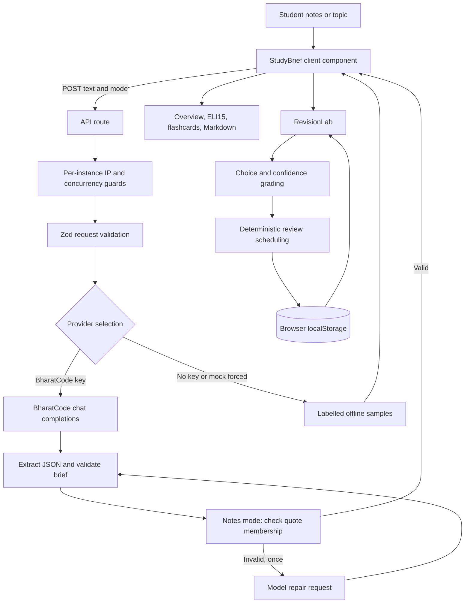

# Architecture and data lifecycle

StudyBrief uses Next.js App Router, React, TypeScript and Zod. Generation runs on the server; practice, scoring, scheduling and saved sessions run in the browser. There is no application database.

The chart simplifies ordering: the IP limiter runs before JSON parsing; request validation precedes concurrency acquisition. The concurrency slot is released in `finally`, including when generation fails. The optional OpenAI development fallback is omitted from the main path; it must be explicitly enabled and is labelled as a test fallback.

## Responsibilities

| File | Responsibility |
|---|---|
| `app/components/StudyBrief.tsx` | Input/mode selection, generation request, overview, flashcards and export |
| `app/components/RevisionLab.tsx` | Hydrate/save the library, question interactions, feedback, round score and deletion |
| `app/api/brief/route.ts` | Provider metadata endpoint, request validation, rate/concurrency limits and error responses |
| `lib/schema.ts` | Request/response types, Zod schemas and model JSON schema |
| `lib/llm.ts` | Provider resolution, model calls, 503 retries, one validation repair |
| `lib/prompt.ts` | General and notes-mode prompts; source text treated as study material |
| `lib/parse.ts` | Extract JSON from model text and validate its structure |
| `lib/learning.ts` | Source membership, session schema, scoring history, scheduling and queue ordering |
| `lib/mock.ts` | Deterministic, visibly labelled offline output |
| `lib/markdown.ts` | Brief export and download filename generation |
| `lib/ratelimit.ts` | In-memory IP window and instance-wide in-flight count |

## Generation and source checks

The model receives a system prompt and the user's text inside source tags. Notes mode adds a required practice array to the requested JSON schema. Returned text is cleaned of think blocks/code fences, parsed, and checked with Zod. Four distinct answer choices and an in-range correct index are required.

For notes-mode output, each quote is checked as a case-sensitive contiguous substring after collapsing whitespace in both quote and source. Other punctuation/word changes are not accepted. A schema or citation failure triggers exactly one repair generation; a second failure rejects the brief. This is a deterministic membership check, not retrieval, entailment verification or fact-checking. The model still chooses the correct answer and writes the explanation.

The default model request has a 4,000-token output budget and temperature 0.3. BharatCode calls include `reasoning_effort: "none"`. The code retries provider HTTP 503 twice, with 2s and 4s waits. Each fetch has a 90s timeout; the route declares a 120s maximum duration, subject to hosting support. Retries/repair can exceed a host's total budget; there is no coordinated end-to-end timeout.

## Learning-state model

`studybrief.revision.v1` stores an array of at most ten sessions in localStorage. Each session contains an ID, creation timestamp, original notes, full generated response and a question-indexed review map. A review stores cumulative attempts/correct answers, current correct streak, cumulative confident mistakes, latest correctness/confidence and next due timestamp.

Hydration parses and validates saved sessions with Zod. Persistence runs after hydration. Storage errors show feedback and leave the current in-memory library usable; damaged saved data is not a supported backup format. The browser's storage is neither encrypted nor user-authenticated by this application.

The queue is a derived view of questions and review dates; it is not a server job queue. No background scheduler runs after the page closes. See [scheduling behavior](FEATURES.md#scheduling-and-gap-tracking).

## Data boundaries and deployment limits

- API credentials stay in the server environment. Provider metadata and generated content are returned to the browser; credentials are not intentionally returned.
- Source notes are sent to the configured model provider. The application has no notes database, but provider retention and host logs are separate concerns.
- The browser stores notes and responses for notes sessions. Topic briefs remain in the current page state and may be exported manually.
- Rate/concurrency state is per running process or warm serverless instance, not globally coordinated. Forwarded client-IP headers must come from a trusted deployment proxy for dependable IP limits.
- There is no user authentication, multi-user authorization, cloud sync, analytics backend or notification infrastructure.

For setup and deployment, see [Operations](OPERATIONS.md). For request/response contracts, see [API](API.md).
